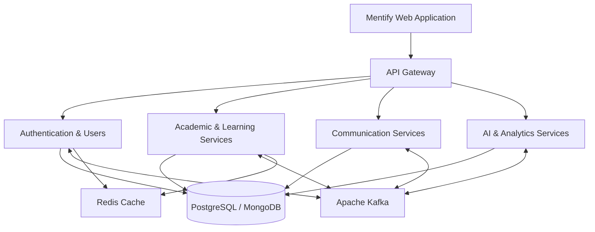

# 🎓 Mentify

### Learn better. Build smarter. Grow together.

An AI-enabled Learning Management System for connected, accessible, and intelligent education.

**[Explore Our Repositories →](https://github.com/SENG-34213?tab=repositories)**

---

## 📖 About Mentify

**Mentify** is an AI-powered Learning Management System (LMS) designed to transform the educational experience for students, teachers, and administrators.

The platform brings together academic management, digital learning, real-time communication, and intelligent AI assistance within a unified ecosystem.

Our mission is to make education more accessible, efficient, engaging, and intelligent through modern technology.

### ✨ What Makes Mentify Different?

- 🎓 Unified learning experience for students and teachers
- 🤖 AI-powered educational assistance
- 📚 Centralized academic and course management
- 📊 Data-driven academic insights
- 💬 Real-time communication and collaboration
- 🔐 Secure role-based access control
- ☁️ Cloud-based infrastructure
- 📱 Modern and responsive user interfaces

---

## 🚀 Key Features

### 🎓 Student Portal

- Personalized student dashboard
- Course enrollment and learning materials
- Video-based learning
- Assignment submission and tracking
- Online quizzes and examinations
- Attendance and academic progress monitoring
- AI-powered learning assistance
- Real-time communication
- Academic calendar and notifications

### 👨‍🏫 Teacher Portal

- Teacher dashboard and academic overview
- Course and syllabus management
- Module and lesson creation
- Assignment and quiz management
- Student performance evaluation
- Attendance management
- AI-assisted quiz generation
- Grading and feedback
- Student communication and notifications

### 🛡️ Administrator Portal

- Centralized administration dashboard
- Student and teacher management
- Grade and course management
- Enrollment administration
- Academic scheduling
- Attendance monitoring
- Examination and assessment oversight
- Academic analytics and reports
- AI-powered administrative assistance
- Platform configuration and management

---

## 🌐 Live Deployment & Demo Access

Mentify is deployed on **Amazon Web Services (AWS)** and provides three role-based web portals.

Visitors can explore the application using the demonstration accounts provided below.

### 🛡️ 1. Administrator Portal

**Portal URL:**

http://13.201.248.101/admin

| Credential | Value |
|------------|-------|
| **Role** | Administrator |
| **Username** | `mohanrasa475@gmail.com` |
| **Password** | `Sample1234#!` |
| **Access** | [Open Admin Portal](http://13.201.248.101/admin) |

Explore administrative features, academic management, course administration, and platform monitoring.

### 👨‍🏫 2. Teacher Portal

**Portal URL:**

http://13.201.248.101/teacher

| Credential | Value |
|------------|-------|
| **Role** | Teacher |
| **Username** | `mohanathasholins17@gmail.com` |
| **Password** | `Sample1234##` |
| **Access** | [Open Teacher Portal](http://13.201.248.101/teacher) |

Explore course management, lessons, assignments, assessments, grading, and AI-assisted teaching tools.

### 🎓 3. Student Portal

**Portal URL:**

http://13.201.248.101/student

| Credential | Value |
|------------|-------|
| **Role** | Student |
| **Username** | `awsconsole1708@gmail.com` |
| **Password** | `Sample1234#!` |
| **Access** | [Open Student Portal](http://13.201.248.101/student) |

Explore course learning, academic progress, quizzes, assignments, learning materials, and AI-powered educational assistance.

### 📋 Demo Access Summary

| Portal | Demo Username | Demo Password |
|--------|---------------|---------------|
| Admin | `mohanrasa475@gmail.com` | `Sample1234#!` |
| Teacher | `mohanathasholins17@gmail.com` | `Sample1234##` |
| Student | `awsconsole1708@gmail.com` | `Sample1234#!` |

### 📝 How to Access Mentify

1. Select the relevant portal URL.
2. Open the login page.
3. Enter the provided demo username.
4. Enter the corresponding demo password.
5. Sign in and explore the available features.

> ⚠️ **Demo Environment Notice**
>
> These credentials must be used only for dedicated demonstration accounts containing non-sensitive sample data.
>
> Publicly accessible demo accounts should have restricted permissions, and must not provide access to real academic records, personal information, production infrastructure, or security settings.
>
> The current deployment URLs use HTTP. HTTPS should be configured before using the application with sensitive information.

---

## 🗂️ Project Repositories

Mentify follows a modular development approach, with separate repositories for backend services, frontend development, infrastructure, testing, and documentation.

### ⚙️ [Mentify Backend](https://github.com/SENG-34213/Mentify-backend)

Spring Boot-based microservices supporting the core business logic and backend functionality.

**Core responsibilities:**

- Authentication and authorization
- User and role management
- Academic and course management
- Assignment and examination processing
- Communication and notifications
- Analytics and reporting
- AI-powered functionality
- Event-driven communication

### 💻 [Mentify Frontend](https://github.com/SENG-34213/frontend)

Next.js-based web application providing modern user experiences for students, teachers, and administrators.

**Core responsibilities:**

- Responsive web interfaces
- Role-based dashboards
- Course learning interfaces
- Assessment and assignment workflows
- Real-time communication
- AI chatbot integration
- Academic analytics visualization

### ☁️ [Mentify Infrastructure](https://github.com/SENG-34213/infra)

Infrastructure configuration and deployment resources for the Mentify ecosystem.

**Technologies and responsibilities:**

- Amazon Web Services
- Docker and containerization
- Kubernetes configuration
- Networking and deployment
- Database infrastructure
- Messaging infrastructure
- Cloud storage
- Continuous integration and delivery

### 🧪 [Mentify Testing](https://github.com/SENG-34213/tests)

Automated testing resources designed to improve application quality and reliability.

**Testing coverage:**

- Unit testing
- Integration testing
- End-to-end testing
- API testing
- Performance testing
- Regression testing

### 📄 [Mentify Documentation](https://github.com/SENG-34213/documents)

Centralized technical and project documentation.

**Documentation includes:**

- Software requirements
- System architecture
- API documentation
- Design specifications
- Technical decisions
- Development guidelines
- User guides

---

## 🛠️ Technology Stack

Mentify uses a modern, scalable, service-oriented technology stack.

| Layer | Technologies |
|-------|-------------|
| **Frontend** | Next.js, React, TypeScript |
| **Backend** | Java 17, Spring Boot, Spring Cloud |
| **Databases** | PostgreSQL, MongoDB |
| **Caching** | Redis |
| **Messaging** | Apache Kafka |
| **Security** | JWT, Role-Based Access Control |
| **AI Integration** | OpenAI |
| **Containerization** | Docker |
| **Orchestration** | Kubernetes |
| **Cloud Infrastructure** | Amazon Web Services |
| **CI/CD** | GitHub Actions |
| **Testing** | Automated Unit, Integration, E2E and Performance Tests |

---

## 🏗️ System Architecture

Mentify follows a microservices-based architecture that separates business capabilities into independently maintainable services.

### High-Level Architecture

### Architectural Principles

- Separation of concerns
- Independently maintainable services
- Secure API communication
- Event-driven processing
- Scalable cloud infrastructure
- Reusable business capabilities
- Reliable and testable components

---

## 🤖 Artificial Intelligence Integration

Mentify integrates AI capabilities to improve learning experiences and support educational productivity.

### AI-Powered Features

- **AI Learning Assistant:** Helps students understand educational topics and concepts.
- **AI Quiz Generation:** Supports automated generation of educational questions.
- **AI Grading Assistance:** Assists teachers with assessment and feedback workflows.
- **AI Administrative Assistance:** Supports academic and administrative activities.
- **AI Learning Support:** Provides contextual educational guidance.

Our approach emphasizes useful, responsible, and accessible AI assistance.

---

## 🎯 Our Mission

We aim to build an intelligent educational platform that empowers students, supports teachers, and simplifies academic administration.

### Our Core Values

- 📚 Quality education
- 🌍 Accessible learning
- 🤝 Collaboration
- 🔒 Security and privacy
- 💡 Innovation
- 🚀 Continuous improvement
- 🤖 Responsible artificial intelligence

---

## 🤝 Contributing

We welcome contributions that improve the Mentify ecosystem.

Contributions may include:

- Bug fixes
- Feature improvements
- Documentation updates
- UI/UX enhancements
- Performance optimization
- Automated tests
- Security improvements

### Contribution Guidelines

1. Explore the relevant repository.
2. Review the existing project structure.
3. Create an issue or discuss your proposed change.
4. Create a feature branch.
5. Implement your changes.
6. Add appropriate tests.
7. Submit a pull request for review.

Please follow the coding standards and contribution guidelines of the repository you are updating.

---

## 🔐 Security

Security and data privacy are important parts of the Mentify platform.

Our development principles include:

- Secure authentication
- Role-based authorization
- Protected API communication
- Environment-based configuration
- Secure credential management
- Access control and permission validation
- Safe handling of educational data

**Important:** Never commit production passwords, API keys, database credentials, or other sensitive information to public repositories.

Public demonstration credentials should only belong to isolated, restricted demo accounts.

---

## 📬 Project Organization

**GitHub Organization:** [SENG-34213](https://github.com/SENG-34213)

**Project:** Mentify — AI-Enabled Learning Management System

**Repositories:** [Explore All Repositories](https://github.com/SENG-34213?tab=repositories)

---

## 🎓 Mentify

### Learn better. Build smarter. Grow together.

*Building the future of intelligent education through technology, collaboration, and innovation.*

**[Backend](https://github.com/SENG-34213/Mentify-backend)** •
**[Frontend](https://github.com/SENG-34213/frontend)** •
**[Infrastructure](https://github.com/SENG-34213/infra)** •
**[Testing](https://github.com/SENG-34213/tests)** •
**[Documentation](https://github.com/SENG-34213/documents)**

---

**Built with ❤️ by the SENG-34213 Team**

